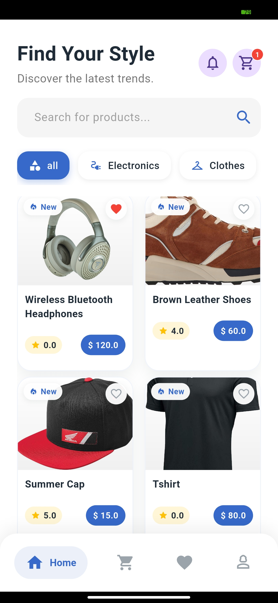
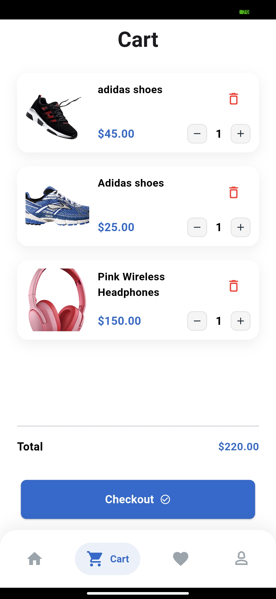
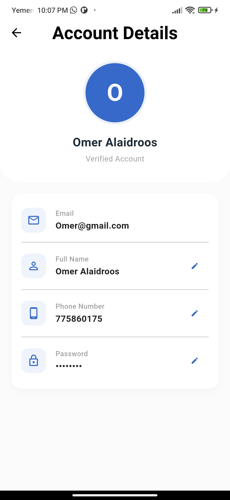
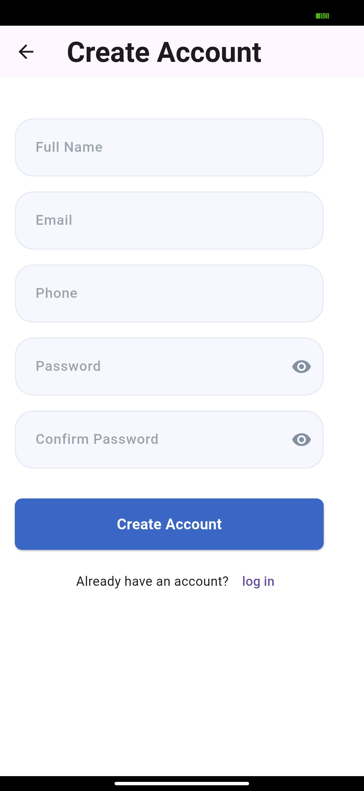

# e-Commerce Flutter App for User

A comprehensive Flutter e-commerce application built with clean architecture and modern state management. Features include user authentication, product browsing with image caching, shopping cart functionality, address management, and responsive UI design. Utilizes BLoC pattern for state management, Dio for API calls, and Go Router for navigation.

## Features

- User authentication and account management
- Product browsing with category filtering
- Product details and reviews
- Favorites and cart management
- Address management and checkout flow
- Responsive UI for modern e-commerce experiences
- Secure API integration and token handling

## Screenshots

<div align="center">










</div>

## Stripe setup

Set the Stripe publishable key before running the app:

- Android/iOS: `flutter run --dart-define=STRIPE_PUBLISHABLE_KEY=your_publishable_key`

## Getting Started

1. Clone the repository
2. Install dependencies:
   ```bash
   flutter pub get
   ```
3. Run the app:
   ```bash
   flutter run
   ```

## Tech Stack

- Flutter
- Dart
- BLoC
- Dio
- Go Router
- Stripe

